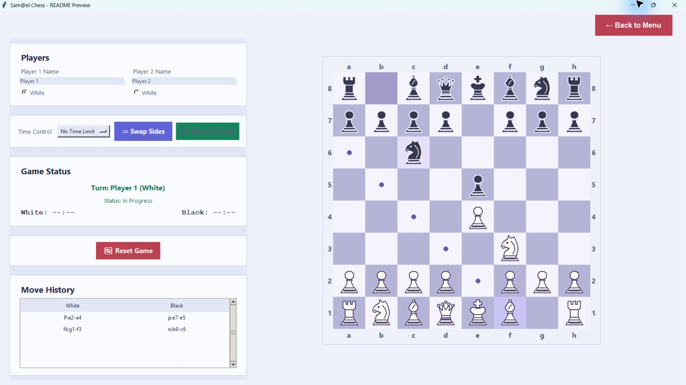
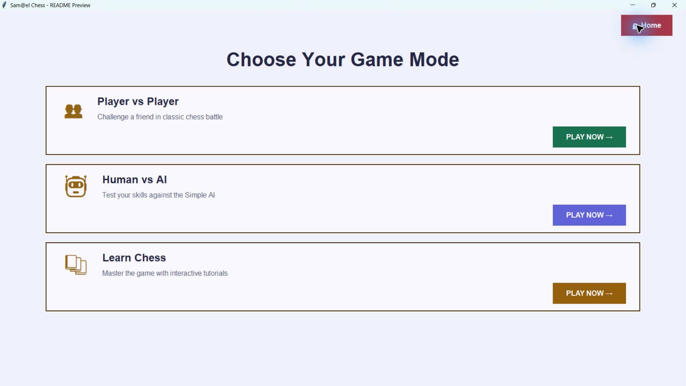
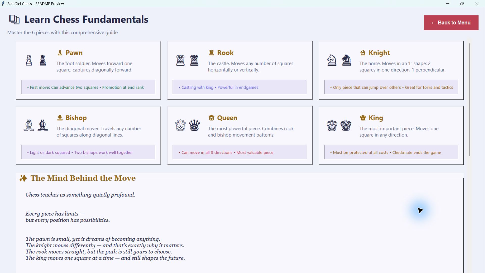

<div align="center">

# Sam@el’s Chess

**A single-file Python chess application with a Tkinter GUI**

Play locally. Challenge the computer. Learn the game.

</div>



## Overview

**Sam@el’s Chess** brings local multiplayer, computer opponents, and automatic game saving into one standalone Python file. Built with Tkinter and SQLite, it features a light lavender interface, custom vector pieces, and an integrated chess-learning guide.

## Features

| Feature | Description |
| --- | --- |
| Game modes | Local player vs player and human vs AI |
| Chess rules | Castling, en passant, promotion, check, checkmate, and stalemate |
| Board interaction | Legal-move dots, capture rings, and check indicators |
| Game tracking | Move history, captured pieces, and last-move highlights |
| Time controls | Untimed, 5, 10, or 30 minutes per player |
| Persistence | Automatic saves, Continue Game, and saved-match history |
| Learn Chess | Piece descriptions, movement guides, and basic rules |

Two AI modes are available: **Club Level** selects random legal moves; **World Champion Level** uses one-move material and mobility evaluation.

## Getting started

**Requirements:** Windows and Python with Tkinter and SQLite support. Tested with Python 3.13. No third-party packages are required.

Download `S@mael Ches.py` and run:

```powershell
python "S@mael Ches.py"
```

Choose a game mode, configure the match, and press **Start Match**. Click a piece, then a highlighted destination to move.

Games save automatically to `%LOCALAPPDATA%\SamaelChess\chess_data.db`. Select **Continue Game** to resume the latest unfinished match.

## Architecture

The application stays in one file while separating responsibilities into classes.

```text
Piece
├── Pawn
├── Knight
├── Bishop
├── Rook
├── Queen
└── King

ChessGame           Board state, move validation, and game outcomes
SimpleAI            Random legal-move selection
StrongAI            One-move material and mobility evaluation
GameDatabase        SQLite persistence and saved-game retrieval
ChessGUI            Application navigation and session coordination
ChessBoardWidget    Board rendering, vector pieces, and click handling
BasePage            Shared interface components
├── WelcomePage
├── ModeSelectionPage
├── PvPPage
│   └── HumanVsAIPage
└── LearnChessPage
```

### Design principles

- **Inheritance:** Each piece specializes the shared `Piece` base class.
- **Polymorphism:** Piece classes implement `get_legal_moves()` for their movement patterns; `ChessGame` filters moves for king safety.
- **Composition:** `ChessGame` owns the board and its piece objects, while the interface coordinates the current game and storage.
- **Separation of responsibilities:** Rule validation, AI evaluation, persistence, and rendering have dedicated classes within the same script.
- **State isolation:** AI simulations use independent copies of the game.
- **Error handling:** Invalid moves, malformed input, and storage failures are handled explicitly.

## Screenshots

### Game-mode selection




### Learn Chess




## Validation

The current build passed **19 automated checks**, covering:

- Move generation, including **8,902 opening positions** through three plies.
- Castling, en passant, all promotion choices, and king safety.
- Checkmate, stalemate, and basic insufficient-material draws.
- AI state isolation, turn controls, and clock timing.
- SQLite save/load, game restoration, and board rendering.

## Author

**San Win**  
Software Engineering Student — KMITL, Thailand
